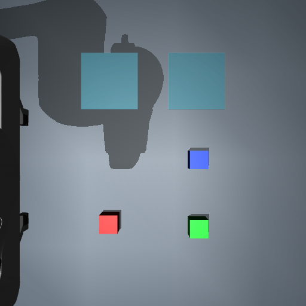
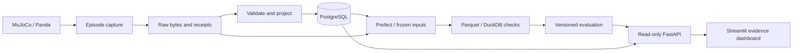

# Robot Episode Data Platform

**A reproducible data-engineering platform for capturing, validating and analyzing simulated robot episodes.**

Robot experiments generate images, events, actions and outcomes. This project preserves their original bytes, validates their relationships, projects queryable metadata and publishes versioned analytical datasets. A read-only dashboard connects each score to its source evidence—including failed tasks and invalid model responses.

Source repository: [utsav-chokshi/robot-episode-data-platform](https://github.com/utsav-chokshi/robot-episode-data-platform). The local Python package, Compose project and volume identifiers retain their existing names so the measured workflow continues to use its original data.



## What this demonstrates

- **Reliable ingestion:** raw-first persistence, identity and reference validation, duplicate-safe replay, quarantine and recovery tests.
- **Analytical data engineering:** PostgreSQL projections, Prefect orchestration, twelve-table Parquet datasets, DuckDB quality checks and immutable input snapshots.
- **Robotics context:** a MuJoCo/Panda structured pick-and-place controller with camera capture, measured lift/placement outcomes and linked observation/action traces.
- **Evaluation discipline:** fixed task assignments, explicit denominators, versioned reports and preserved model failures. Model proposals never execute robot actions.

## Verified platform results

| Engineering check | Observed result |
| --- | --- |
| Core, analytics, evaluation and dashboard checks | **110 passed locally**, with passing GitHub Actions jobs |
| Duplicate-safe raw replay | **71 robot episodes + 93 experimental proposal attempts** replayed without adding database facts |
| Frozen dataset rebuilds | **Three dataset versions** matched their logical tables and metrics |
| Fresh application-volume reproduction | Capture → ingestion → real Prefect flow → dataset rebuild → evaluation → dashboard verified |
| Structured simulator baseline | **54/54** successful tasks in the fixed, bounded scene |

Replay totals include development and exploratory model evidence; they are data-integrity checks, not model accuracy. The structured controller uses known simulator handles. Repetition seeds do not establish broad scene variation or physical-robot performance.

See [validation](docs/validation.md) and [portable results and identities](docs/evidence/benchmark-results.json). Archived evidence describes the measured runs; a new local setup starts with its own volumes. Improving language-driven planning is [future enhancement work](docs/future-enhancements.md); the existing experimental evaluation remains documented separately.

## Architecture



Replay, rebuilds and dashboard views cannot dispatch robot actions. An optional experimental adapter also produces proposal evidence; its evaluation history and future improvements are documented separately. See [the implemented architecture and tradeoffs](docs/architecture.md).

## Stack

Python 3.12 · MuJoCo/Panda · FastAPI/Pydantic · PostgreSQL/Alembic · Prefect · PyArrow/Parquet · DuckDB · Streamlit · pytest · Docker Compose. Optional local CPU inference: PyTorch/Transformers and pinned SmolVLM-256M. No paid API or GPU is required.

## Quick start: capture → dataset → dashboard

Use Docker Desktop with Linux containers and Compose. The verified host is Windows/PowerShell with Linux/amd64 containers. Initial builds download dependencies and robot assets. The optional model requires a separate weights-preparation step. Other host platforms are unverified; Linux/macOS environment setup is described in [development](docs/development.md).

Run from this repository's root:

```powershell
./scripts/Initialize-LocalEnvironment.ps1
docker compose up --build -d --wait api
docker compose --profile simulation run --build --rm simulator suite
docker compose --profile ingestion run --rm ingestor
docker compose --profile pipelines run --build --rm pipeline
docker compose --profile dashboard up --build -d --wait dashboard
```

- Dashboard: [localhost:8501](http://localhost:8501)
- API documentation: [localhost:8010/docs](http://localhost:8010/docs)
- Prefect: [localhost:4201](http://localhost:4201)

This creates the 17-case development suite and its dataset, not the archived 144-attempt benchmark. Failed grasps and rejected requests are expected development cases. The pipeline command starts its required Prefect service. Change the host mapping in Compose if another service occupies a port.

Initialization preserves an existing `.env` and generates a random local password on first use. Do not regenerate credentials against a retained PostgreSQL volume. PostgreSQL is not host-published; the user interfaces bind to localhost. Named data volumes survive normal shutdown:

```powershell
docker compose --profile '*' down
```

## Future enhancements: language-driven planning

The completed core is the episode data platform. Future work will improve the experimental language-planning provider, add constrained output generation and evaluate broader scenes before considering any execution integration. An exploratory adapter and its original unsuccessful evaluation already exist; these are not a validated planning capability. See the [future enhancement plan](docs/future-enhancements.md) and [archived experimental benchmark](docs/benchmark-validation.md) for the existing results and reproduction commands.

For an interactive review, follow the [three-minute demo](docs/demo-walkthrough.md). No hosted backend or prerecorded video is claimed.

## Verification and reproduction

```powershell
docker compose --profile test run --build --rm pipeline-tests
docker compose --profile dashboard run --build --no-deps --rm dashboard /opt/dashboard/bin/python -m pytest -q -p no:cacheprovider tests/test_dashboard.py
```

Core/analytics tests use an isolated PostgreSQL test service. Dashboard checks run in their own dependency environment. The local 110-test result covers specific failures and recovery boundaries; the [GitHub Actions workflow](https://github.com/utsav-chokshi/robot-episode-data-platform/actions) also passed its core/data-platform, simulator and dashboard jobs on the initial published commit.

After building the component images and preparing the optional model cache, [Validate-CleanWorkspace.ps1](scripts/Validate-CleanWorkspace.ps1) runs the full smoke workflow with fresh application volumes in a separate Compose namespace. It reuses built images and read-only prepared weights; it does not test a cold internet download, a fresh OS or host power loss.

## Explore the project

| Topic | Read |
| --- | --- |
| Data path, boundaries and tradeoffs | [Architecture](docs/architecture.md) |
| Capture and simulator | [Simulator](docs/simulator.md) |
| Raw-first intake, replay and recovery | [Ingestion](docs/ingestion.md) |
| Frozen inputs and analytical tables | [Analytics](docs/analytics.md) |
| Planned model improvements and existing experiment | [Future enhancements](docs/future-enhancements.md) |
| Evaluation and five dashboard views | [Dashboard](docs/evaluation-dashboard.md) |
| Fixed benchmark and limits | [Benchmark validation](docs/benchmark-validation.md) |
| Verification history | [Validation](docs/validation.md) |

Original application code is MIT licensed. The pinned Panda asset retains Apache 2.0; dependencies and downloaded model weights retain their own terms. See [third-party notices](THIRD_PARTY.md). The project does not implement ROS 2 integration, real-robot deployment, arbitrary-scene manipulation, a streaming broker or distributed exactly-once processing.
