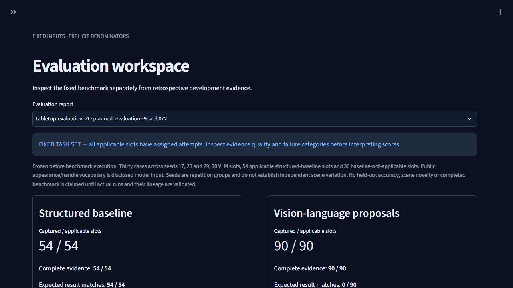
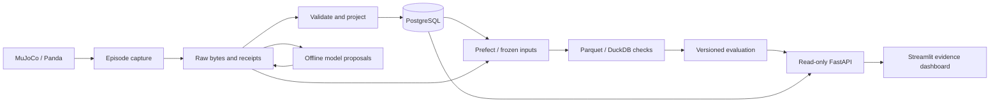

# Robot Episode Data Platform

**A reproducible data-engineering platform for simulated robot episodes and vision-language model evaluation.**

Robot experiments generate images, events, actions and outcomes. This project preserves their original bytes, validates their relationships, projects queryable metadata and publishes versioned analytical datasets. A read-only dashboard connects each score to its source evidence—including failed tasks and invalid model responses.

Built by Utsav Chokshi as a standalone portfolio project for robotics data-engineering roles.

Source repository: [utsav-chokshi/robot-episode-data-platform](https://github.com/utsav-chokshi/robot-episode-data-platform). The local Python package, Compose project and volume identifiers retain their existing names so the measured workflow continues to use its original data.



## What this demonstrates

- **Reliable ingestion:** raw-first persistence, identity and reference validation, duplicate-safe replay, quarantine and recovery tests.
- **Analytical data engineering:** PostgreSQL projections, Prefect orchestration, twelve-table Parquet datasets, DuckDB quality checks and immutable input snapshots.
- **Robotics context:** a MuJoCo/Panda structured pick-and-place controller with camera capture, measured lift/placement outcomes and linked observation/action traces.
- **Evaluation discipline:** fixed task assignments, explicit denominators, versioned reports and preserved model failures. Model proposals never execute robot actions.

## Measured results

Local benchmark, 2026-11-09: 30 instruction cases × three repetition seeds. The structured controller supports 54 slots; 36 language-only slots are not applicable to it.

| Configuration | Complete evidence | Result |
| --- | --- | --- |
| Structured robot baseline | 54/54 | 54/54 physical task successes |
| SmolVLM-256M proposal-only evaluation | 90/90 | 90/90 inference completions; **0/90 schema-valid plans** |
| Regression checks | 103 core/analytics + 7 dashboard | **110 passed locally** |

The tested model is unsuitable for task selection under this configuration. The engineering result is a pipeline that retains and explains this failure instead of hiding it. VLM physical success is not applicable. Seeds are repetition groups within a bounded scene; these scores do not establish general visual grounding or physical-robot performance.

Model worker-wall latency: p50 **17.49 s**, p95 **24.88 s**. Ninety sequential model slots took about **28.1 minutes** on an i5-6500T CPU. The model container had two CPUs and a 6 GiB limit; largest periodic memory sample was about 1.44 GiB, not an exhaustive peak.

See [benchmark methodology](docs/benchmark-validation.md), [portable results and identities](docs/evidence/benchmark-results.json) and the [complete evaluation report](docs/evidence/evaluation-report.json). Archived evidence describes the measured run; a new local setup starts with its own empty volumes.

## Architecture



Model inference receives an approved image, instruction and public vocabulary. Evaluator targets and reference poses remain outside the model request. Replay, rebuilds and dashboard views cannot dispatch robot actions. See [the implemented architecture and tradeoffs](docs/architecture.md).

## Stack

Python 3.12 · MuJoCo/Panda · FastAPI/Pydantic · PostgreSQL/Alembic · Prefect · PyArrow/Parquet · DuckDB · Streamlit · pytest · Docker Compose. Optional local CPU inference: PyTorch/Transformers and pinned SmolVLM-256M. No paid API or GPU is required.

## Quick start: capture → dataset → dashboard

Use Docker Desktop with Linux containers and Compose. The verified host is Windows/PowerShell with Linux/amd64 containers. Initial builds download dependencies and robot assets. The optional model requires a separate weights-preparation step. Other host platforms are unverified; Linux/macOS environment setup is described in [development](docs/development.md).

Run from this repository's root:

```powershell
./scripts/Initialize-LocalEnvironment.ps1
docker compose up --build -d --wait api
docker compose --profile simulation run --build --rm simulator suite
docker compose --profile ingestion run --rm ingestor
docker compose --profile pipelines run --build --rm pipeline
docker compose --profile dashboard up --build -d --wait dashboard
```

- Dashboard: [localhost:8501](http://localhost:8501)
- API documentation: [localhost:8010/docs](http://localhost:8010/docs)
- Prefect: [localhost:4201](http://localhost:4201)

This creates the 17-case development suite and its dataset, not the archived 144-attempt benchmark. Failed grasps and rejected requests are expected development cases. The pipeline command starts its required Prefect service. Project 1 uses the same default dashboard port: stop its dashboard first if necessary. Change the host mapping in Compose if another service occupies a port.

Initialization preserves an existing `.env` and generates a random local password on first use. Do not regenerate credentials against a retained PostgreSQL volume. PostgreSQL is not host-published; the user interfaces bind to localhost. Named data volumes survive normal shutdown:

```powershell
docker compose --profile '*' down
```

## Optional model and full benchmark

[Model preparation and one-attempt commands](docs/proposals.md) explain the pinned model cache, offline runtime and strict plan contract. [Fixed benchmark commands](docs/benchmark-validation.md) execute all 54 structured and 90 proposal attempts, ingest them and publish a dataset-linked report. Budget about 28 minutes for measured CPU inference, plus builds and data processing. The full retained audit corpus includes older development attempts; benchmark denominators come from the report's fixed assignments.

For an interactive review, follow the [three-minute demo](docs/demo-walkthrough.md). No hosted backend or prerecorded video is claimed.

## Verification and reproduction

```powershell
docker compose --profile test run --build --rm pipeline-tests
docker compose --profile dashboard run --build --no-deps --rm dashboard /opt/dashboard/bin/python -m pytest -q -p no:cacheprovider tests/test_dashboard.py
```

Core/analytics tests use an isolated PostgreSQL test service. Dashboard checks run in their own dependency environment. The local 110-test result covers specific failures and recovery boundaries; a configured GitHub Actions workflow is included, but no remote CI run has been observed.

After building the component images and preparing the optional model cache, [Validate-CleanWorkspace.ps1](scripts/Validate-CleanWorkspace.ps1) runs the full smoke workflow with fresh application volumes in a separate Compose namespace. It reuses built images and read-only prepared weights; it does not test a cold internet download, a fresh OS or host power loss.

## Explore the project

| Topic | Read |
| --- | --- |
| Data path, boundaries and tradeoffs | [Architecture](docs/architecture.md) |
| Capture and simulator | [Simulator](docs/simulator.md) |
| Raw-first intake, replay and recovery | [Ingestion](docs/ingestion.md) |
| Frozen inputs and analytical tables | [Analytics](docs/analytics.md) |
| Model contract and provenance | [Proposals](docs/proposals.md) |
| Evaluation and five dashboard views | [Dashboard](docs/evaluation-dashboard.md) |
| Fixed benchmark and limits | [Benchmark validation](docs/benchmark-validation.md) |
| Verification history | [Validation](docs/validation.md) |

Original application code is MIT licensed. The pinned Panda asset retains Apache 2.0; dependencies and downloaded model weights retain their own terms. See [third-party notices](THIRD_PARTY.md). The project does not implement ROS 2 integration, real-robot deployment, arbitrary-scene manipulation, a streaming broker or distributed exactly-once processing.
