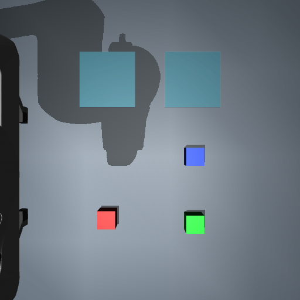
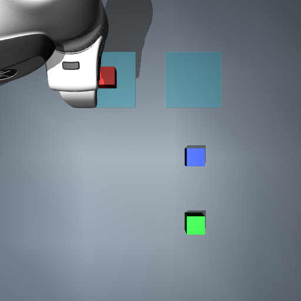

# Three-minute evidence walkthrough

This is a live-demo guide and recording script, not a claim that a video has already been recorded. Use the packaged screenshots when Docker is unavailable.

## Before presenting

Start the dashboard from the README. For measured benchmark views, finish the benchmark publication in [benchmark-validation.md](benchmark-validation.md) and select its dataset. A development-only quick start will show its own smaller cohort; do not present it as the fixed benchmark. Images below are an illustrative development episode, separate from benchmark scores.

## 0:00–0:35 — problem and data path

“I built a data platform for robotics experiments. It links captured images, events, actions and outcomes to immutable analytical datasets, so a result can be traced back to the exact evidence that produced it.”

Show Overview. Point out audit totals versus the selected cohort's physical-success denominator. Explain PostgreSQL metadata, raw bytes, Prefect orchestration and Parquet/DuckDB publication.

## 0:35–1:10 — one robot episode

Open Episodes and select a successful run. Show initial/final observations, event order and measured action outcomes. The controller uses known simulator handles; it is not image-driven selection.

| Before | After |
| --- | --- |
|  |  |

These are actual Step 6 captures from development episode `916f46ca-9ed8-4b50-8a22-7866bc0ea949`; they illustrate trace inspection, not additional benchmark trials.

## 1:10–1:50 — show the negative model result

Open Evaluations on benchmark dataset `c4715fa5-51e9-427a-8d2b-aed006dc5066`. Show 54/54 structured success, 90/90 proposal evidence and 0/90 valid plans. Then open Proposals to inspect an original invalid response and model provenance.

“Inference completion is different from a valid plan. This small CPU model failed the required plan format in every benchmark attempt. I retained those outputs and kept proposals unable to execute robot actions.”

## 1:50–2:30 — reliability and reproducibility

Show Data quality and a dataset/report identity. Explain that raw replay produced 71 baseline and 93 proposal duplicates without changing facts. Rebuilding old and new snapshots matched logical tables and metrics. The isolated fresh-volume smoke check ran a real Prefect flow through evaluation and dashboard health.

## 2:30–3:00 — judgment and next work

“My focus is the data lifecycle and evaluation evidence. Robotics gives the data meaningful structure; the model is a replaceable experimental producer. Next I would expand scene coverage and evaluate a new provider as a new version, while preserving this run.”

Mention the bounded scene, repetition seeds and lack of physical-robot/production-scale validation. Keep model validity and physical task success separate.
